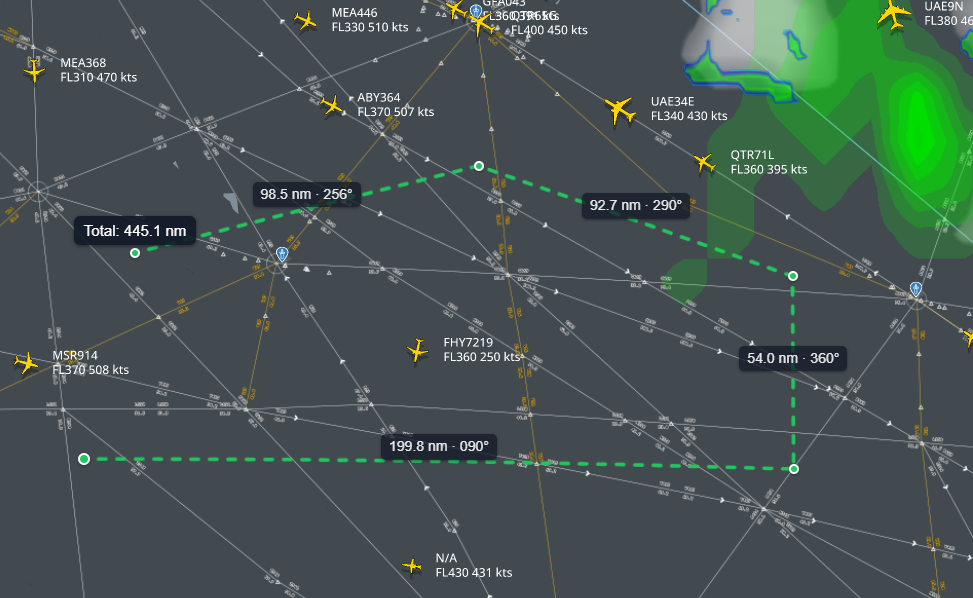
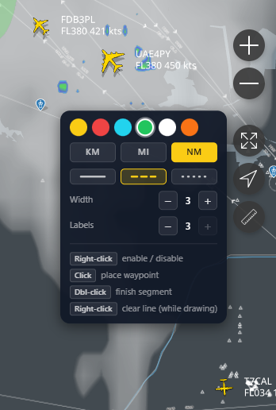

# RadarRuler

Chrome extension that adds a geodesic distance and bearing measurement tool to [FlightRadar24](https://www.flightradar24.com/) - click to place waypoints, get per-segment distances, and measure multi-leg routes directly on the map.

---

## Features

**Multi-segment route measurement**
Click to place waypoints and build up a multi-leg route across the map. Each segment is drawn as a geodesic line. Double-click to finish. A total distance label appears above the final waypoint.

**Per-segment distance and bearing labels**
Every segment shows a label at its midpoint with the distance and magnetic bearing - for example `12.4 nm / 045°`. Labels stay anchored to their geographic position as you pan and zoom.

**Configurable line appearance**
Line colour, style (solid, dashed, dotted), thickness, and label size are adjustable from the settings flyout. Six preset colours are available. Settings persist across page reloads.

**Right-click controls**
Right-click anywhere on the map to enable the tool, clear the active line mid-draw, or disable the tool when idle - without moving the mouse to the button.

<table>
  <tr>
    <td></td>
    <td></td>
  </tr>
  <tr>
    <td align="center">Multi-segment route measurement</td>
    <td align="center">Settings flyout</td>
  </tr>
</table>

---

## Installation

1. Download or clone this repository.
2. Open Chrome and navigate to `chrome://extensions`.
3. Enable **Developer mode** (toggle in the top-right corner).
4. Click **Load unpacked** and select the `RadarRuler` folder.
5. Navigate to `https://www.flightradar24.com/`.

The measurement button appears in the map controls on the right side of the map, below the location button.

---

## Usage

| Action | Result |
|---|---|
| Right-click on map | Enable the tool |
| Click | Place a waypoint |
| Double-click | Finish the current route |
| Right-click while drawing | Clear the active line |
| Right-click when idle | Disable the tool |
| Hover the button | Open settings flyout |

Changing any setting in the flyout automatically enables the tool.

---

## Settings

| Setting | Options |
|---|---|
| Colour | Yellow, Red, Cyan, Green, White, Orange |
| Unit | Nautical miles (nm), Kilometres (km), Miles (mi) |
| Line style | Solid, Dashed, Dotted |
| Line width | 1 to 8 (stepper) |
| Label size | 1 to 3 (stepper) |

---

## Architecture

| File | Content script world | Purpose |
|---|---|---|
| `main.js` | MAIN | Map capture, drawing logic, distance and bearing calculations |
| `ui.js` | ISOLATED | Button injection, flyout UI, settings persistence |
| `ui.css` | n/a | Flyout styles |

The two content script worlds cannot share JavaScript objects directly. They communicate via `window.postMessage` with a `{ source: 'radar-ruler' }` namespace guard.

The map instance is captured by wrapping `google.maps.Map.prototype` methods. Overlays (waypoint dots, segment labels, total label) are implemented as `google.maps.OverlayView` instances so they stay anchored to geographic coordinates across pan and zoom.

---

## Compatibility

Tested against FlightRadar24 with Google Maps JS API v3.65. The extension relies on the following DOM and API assumptions:

- The location button has `id="location-button"` and is used as the anchor for button injection.
- The button uses Tailwind utility classes matching the surrounding FR24 controls.
- `google.maps.geometry.spherical` is available (loaded by FR24).

If FR24 updates its frontend and the button or map capture stops working, see the troubleshooting section below.

---

## Troubleshooting

**Button not appearing**

Open DevTools on `https://www.flightradar24.com/` and check the Console for errors from `radar-ruler`. The MutationObserver in `ui.js` watches `document.body` for re-injection after SPA navigations. If FR24 has renamed the location button, update `findAnchor()` in `ui.js`.

**Map not detected**

The extension captures the map by wrapping `google.maps.Map.prototype` methods. If the tool shows no response after clicking, pan or zoom the map once to trigger a wrapped method call. If the geometry library has not loaded yet, wait a few seconds and try again.

**Aircraft selection fires while measuring**

The extension intercepts clicks via a capture-phase listener. If FR24 updates its event binding order and aircraft selection starts firing through, change the event from `click` to `mousedown` in both `attachListeners` and `detachListeners` in `main.js`.

---

## License

MIT

## Attribution

Extension icon by [bukeicon](https://www.magnific.com/icon/ruler_3171707) via [Magnific](https://www.magnific.com)

Button icon by [kmg design](https://www.magnific.com/icon/bow_2530471) via [Magnific](https://www.magnific.com)
